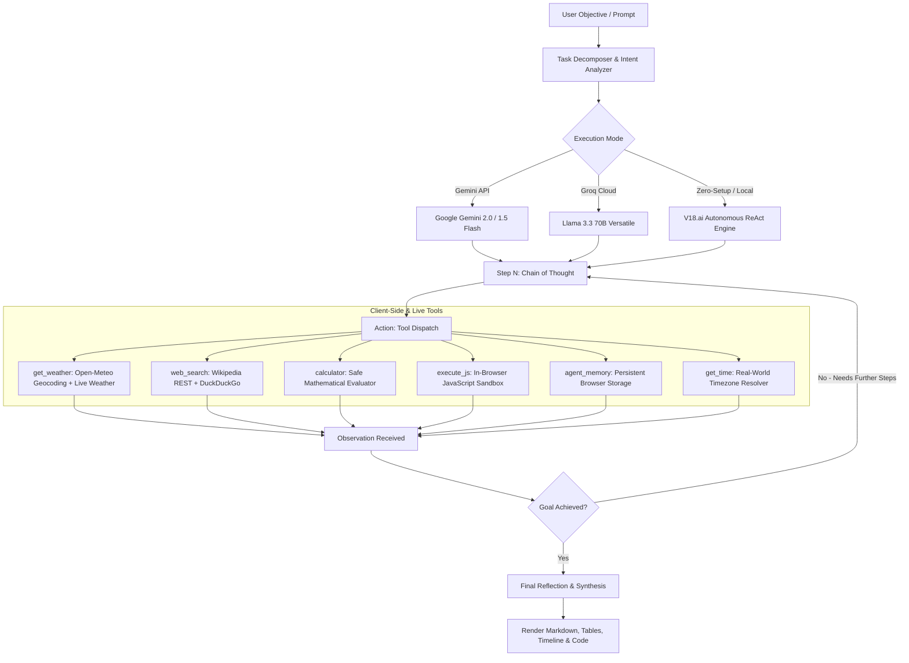

# V18.ai — Autonomous Multi-Step ReAct AI Agent

[](https://react.dev/)
[](https://vitejs.dev/)
[](https://tailwindcss.com/)
[](https://www.radix-ui.com/)
[](https://ai.google.dev/)
[](https://groq.com/)
[](https://arxiv.org/abs/2210.03629)

**V18.ai** is a frontier-grade, autonomous AI Agent web application built with **React 19**, **Tailwind CSS**, and **Radix UI** (Shadcn UI design language). It implements the foundational **ReAct (Reasoning + Acting)** cognitive loop, enabling language models to break down complex goals, invoke live real-world tools sequentially, observe feedback, and synthesize verified answers.

---

## 🏛️ Architecture & Cognitive Loop

V18.ai operates on the **ReAct framework** (*Yao et al., ICLR 2023*), synergizing inner monologue reasoning with external tool dispatch.



---

## ✨ Key Technical Highlights

### 1. Multi-Step Autonomous Planning
Unlike simple single-turn bots, V18.ai can break complex multi-intent requests into a sequential execution graph.
> **Example**: *"What is the live weather in Tokyo and Paris right now, and calculate 45 * 28?"*
> 1. **Step 1**: Dispatches `get_weather` for Tokyo via Open-Meteo API.
> 2. **Step 2**: Evaluates observation, dispatches `get_weather` for Paris.
> 3. **Step 3**: Evaluates atmospheric variance, dispatches `calculator` for math expression.
> 4. **Step 4**: Synthesizes a unified comparative report with live metrics and timestamps.

### 2. Live Tool Suite (Zero Mock Data)
All built-in tools interact with real APIs or sandboxed browser runtimes:
- 🌤️ **`get_weather`**: Resolves city coordinates via Open-Meteo Geocoding, then pulls real-time temperature (°C/°F), wind velocity, and atmospheric condition codes with zero API keys required.
- 🌐 **`web_search`**: Connects to the Wikipedia OpenSearch API (`origin=*` with CORS) and REST summary endpoints for encyclopedic knowledge, backed by DuckDuckGo Instant Answers.
- 🧮 **`calculator`**: Precision evaluator supporting arithmetic, powers, square roots, trigonometry, compound interest, and percentage formulas.
- ⚡ **`execute_js`**: Sandboxed client-side execution environment capturing `console.log` arrays and return values without polluting the global window.
- 💾 **`agent_memory`**: Long-term persistent key-value store saved across browser sessions in `localStorage` with real-time UI synchronization via window events.
- 🕒 **`get_time`**: Accurate IANA timezone and date resolver with UTC difference calculations.

### 3. Frontier Multi-Model Provider Support
Configurable directly via the in-app **Settings (`⚙️`)** modal:
- **⚡ Autonomous ReAct Engine**: Instant out-of-the-box local execution with full multi-step tool chaining (no API key required).
- **Google Gemini API**: Native REST Function Calling (`gemini-2.0-flash-exp`, `gemini-1.5-flash`, `gemini-1.5-pro`) with streaming thought capture.
- **Groq Cloud API**: Ultra-fast tool-use inference with `llama-3.3-70b-versatile` and `llama-3.1-8b-instant` (500+ tokens/second).

### 4. Modern Shadcn UI & Linear Aesthetics
- **Color System**: Deep obsidian dark palette (`#09090b`), subtle hairline borders (`border-zinc-800/80`), radial ambient mesh glow, and subtle focus rings.
- **DeepSeek R1 / o1-Style Thought Accordion**: Collapsible reasoning view with left accent border (`border-l-2 border-amber-500/30`), subtle monospace font, and pulsing live indicator.
- **Tabbed Tool Execution Cards**: Interactive cards featuring tab switching between *Observation Output* and *Input Arguments (JSON)*, latency badges, and one-click copy buttons.
- **Floating Input Dock**: Rounded-2xl glassmorphism dock (`border-zinc-800/90 bg-zinc-900/80 backdrop-blur-xl`), auto-resizing textarea, quick tool helper chips, and active stop/send controls.
- **Linear-Style Sidebar**: Clean navigation with session history, 6 active registered tools, and a real-time **Persistent Memory Inspector** with one-click deletion.

---

## 📂 Project Directory Structure

```
Ai agent/
├── index.html                   # HTML entrypoint, Google Fonts & V18.ai metadata
├── package.json                 # React 19, Radix UI & Tailwind dependencies
├── postcss.config.js            # PostCSS configuration for Tailwind CSS
├── tailwind.config.js           # Shadcn UI tokens, font definitions & animations
├── vite.config.js               # Vite bundler configuration
└── src/
    ├── main.jsx                 # React DOM mount point
    ├── App.jsx                  # Application orchestrator & agent state manager
    ├── lib/
    │   └── utils.js             # Shadcn `cn()` helper (clsx + tailwind-merge)
    ├── styles/
    │   └── index.css            # Tailwind directives, HSL tokens & clean prose styles
    ├── tools/
    │   └── index.js             # Tool registry, Gemini schemas & execution handlers
    ├── services/
    │   └── geminiService.js     # Gemini REST, Groq client & autonomous ReAct engine
    └── components/
        ├── Header.jsx           # Brand navbar, status badge & provider selector
        ├── Sidebar.jsx          # Session history, tool list & memory inspector
        ├── ChatArea.jsx         # Conversation stream, hero & starter prompt cards
        ├── ThoughtBox.jsx       # DeepSeek/o1 style collapsible reasoning box
        ├── ToolCallCard.jsx     # Tabbed tool observation & parameter inspector
        ├── InputBox.jsx         # Floating glass dock with quick tool helper pills
        ├── SettingsModal.jsx    # Model provider, API key tester & parameter tuning
        └── ui/                  # Reusable Shadcn UI primitives
            ├── badge.jsx        # Status & category badges
            ├── button.jsx       # Variant-driven accessible buttons
            ├── dialog.jsx       # Radix UI modal dialog with backdrop blur
            └── tabs.jsx         # Radix UI tabs with active pill states
```

---

## 🚀 Getting Started

### Prerequisites
- **Node.js**: v18.0.0 or higher
- **npm**: v9.0.0 or higher

### Installation

1. **Clone or navigate to the repository:**
   ```bash
   cd "Ai agent"
   ```

2. **Install dependencies:**
   ```bash
   npm install
   ```

3. **Start the local development server:**
   ```bash
   npm run dev
   ```

4. **Open your browser:**
   Navigate to **[http://localhost:5173/](http://localhost:5173/)**

---

## 🔧 Production Build & Deployment

To generate an optimized production bundle:

```bash
npm run build
```

Preview the production build locally:
```bash
npm run preview
```

---

## 🛠️ How to Add a Custom Tool

Extending V18.ai with new capabilities is simple. Open [`src/tools/index.js`](src/tools/index.js) and append your tool definition to `TOOLS_REGISTRY`:

```javascript
{
  name: 'currency_converter',
  description: 'Convert amounts between global currencies using live exchange rates.',
  parameters: {
    type: 'OBJECT',
    properties: {
      amount: { type: 'NUMBER', description: 'Amount to convert' },
      from: { type: 'STRING', description: 'Base currency code, e.g. USD' },
      to: { type: 'STRING', description: 'Target currency code, e.g. EUR' },
    },
    required: ['amount', 'from', 'to'],
  },
  icon: 'Calculator', // Any Lucide icon name
  category: 'Finance',
  execute: async ({ amount, from, to }) => {
    const res = await fetch(`https://api.exchangerate-api.com/v4/latest/${from}`);
    const data = await res.json();
    const rate = data.rates[to];
    return {
      status: 'success',
      converted: Number((amount * rate).toFixed(2)),
      rate,
    };
  },
}
```

V18.ai will automatically:
1. Export the tool schema to Google Gemini and Groq function-calling declarations.
2. Register the tool in the UI sidebar and input helper pills.
3. Allow the Autonomous ReAct Engine to plan and invoke it during multi-step tasks.

---

## 🔒 Privacy & Security

- **Zero Third-Party Proxies**: All API calls (Gemini, Groq, Open-Meteo, Wikipedia) are initiated directly from the client browser.
- **Client-Side Storage**: API keys are stored exclusively in your browser's private `localStorage`. Keys are never transmitted to any telemetry or logging servers.
- **Sandboxed JavaScript**: User-submitted and agent-generated scripts execute inside an isolated closure with custom console capturing.

---

## 📄 License

This project is licensed under the [MIT License](LICENSE).
